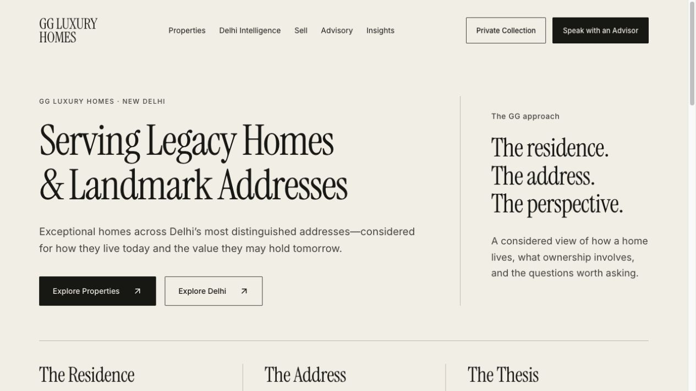
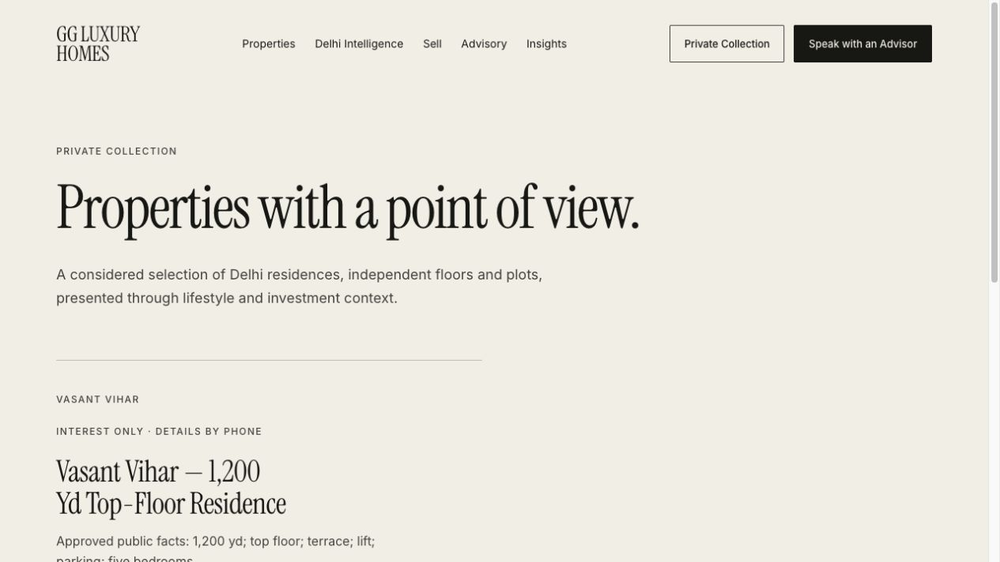
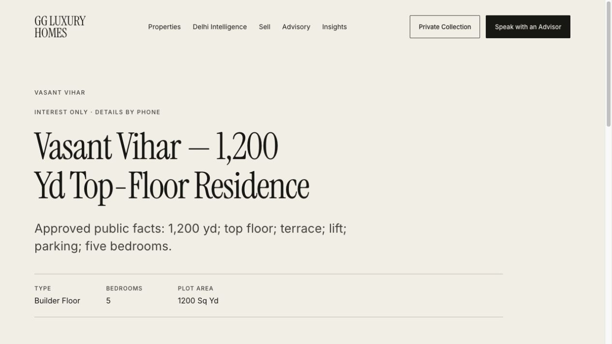
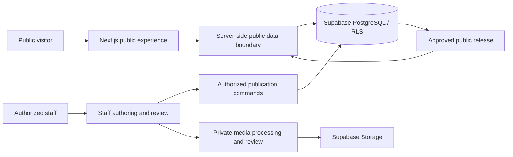

# GG Luxury Homes — from advisory brief to deployed product

**Role:** application engineering and delivery · **Product:** website for a New Delhi real-estate advisory · **Source:** private

[Live website](https://gg-luxury-homes.vercel.app/) · [Property collection](https://gg-luxury-homes.vercel.app/properties) · [Back to profile](../README.md)

## The problem

A luxury property advisory needs more than a gallery. Buyers need enough context to start a useful conversation, while owners and advisors need control over confidential details. The engineering challenge was to connect an editorial public experience to controlled property publication.

I built the application around that distinction: public discovery and approved facts on one side; staff authoring, review, and publication on the other.

*Live homepage captured on October 15, 2026. These are actual public pages, not design mockups.*

## My contribution

I implemented the Next.js/TypeScript application and its property publication workflows, including the public collection and Property Passport experience, staff property authoring, media review, and publication/withdrawal integration. I also worked on staff MFA enrollment and recovery journeys and refined the public experience for interest-only property publication.

The work includes database-backed authorization, public/private data separation, and validation across application, database-policy, concurrency, and browser layers. This account describes engineering work; the business supplies property facts, disclosure approval, and advisory judgment.

## Walk through the deployed product

1. **Start with the advisory.** The homepage explains the service and offers property discovery or an advisor conversation.
2. **Browse approved inventory.** The public collection shows the current published offering without exposing the internal inventory model.
3. **Open a Property Passport.** The current interest-only residence presents approved facts and directs detailed discussion to an advisor.
4. **Keep commercial details confidential.** The live page explicitly reserves availability, commercial terms, exact location, and supporting documents for direct consultation.

*The screenshots show the current interest-only release. They do not imply that a full evidence/media Passport has been published for this residence.*

## Architecture

**Stack:** Next.js App Router, React, TypeScript, Supabase PostgreSQL/Auth/Storage, Vercel. Supporting verification uses unit tests, database policy tests, concurrency checks, and Chrome browser workflows.

## Decisions and trade-offs

| Decision implemented | Why it fits the product | Cost or constraint |
| --- | --- | --- |
| One modular Next.js application | Keeps public and staff workflows in a coherent application | Server/client boundaries must be maintained carefully |
| Database row-level security plus server authorization | Public visibility is enforced beyond UI presentation | Policy and session behavior require dedicated integration tests |
| Separate approved public releases from editable drafts | Prevents an unfinished edit from becoming a public fact | Publication and withdrawal need explicit transactional workflows |
| Private originals and reviewed media delivery | Supports rights/privacy review before disclosure | Processing and delivery need additional validation |
| Interest-only publication | Lets the business publish approved essentials without inventing missing evidence or media | Public visitors must contact an advisor for further details |

These are explanations of the implemented design and its trade-offs, rather than claims that every alternative was benchmarked.

## Evidence and limits

The live homepage, collection, and interest-only property page were inspected on October 15, 2026. The private engineering record also contains local application, database-policy, concurrency, and Chrome workflow verification for recorded revisions. Those historical checks are distinct from this live public-page inspection.

No staff accounts, internal screens, private source, credentials, owner information, exact addresses, or unpublished inventory are included here. Inquiry delivery and staff flows were not re-exercised during this case-study capture. No traffic, revenue, conversion uplift, or production service-level claim is made.

## What this project demonstrates

Translating a business workflow into a product, connecting public UX to controlled data publication, and treating authorization, media handling, and withdrawal as core engineering requirements.

[Explore the live website →](https://gg-luxury-homes.vercel.app/)
