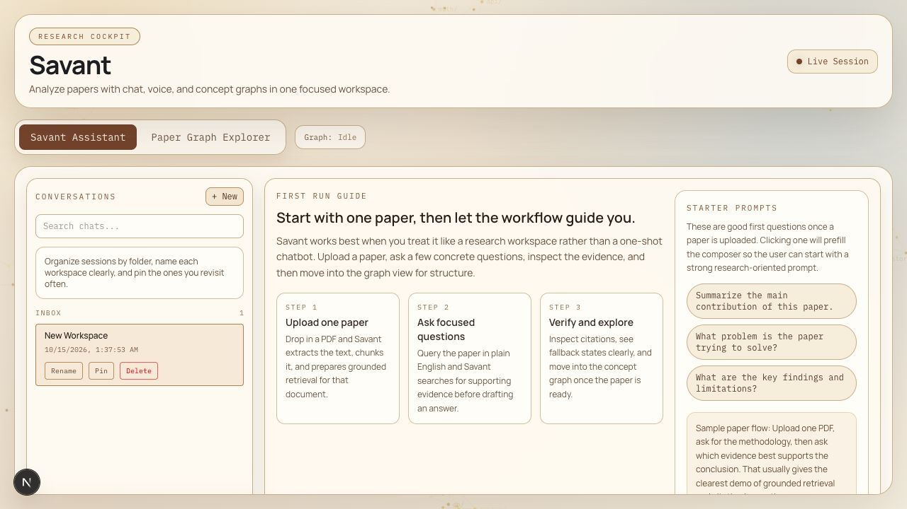
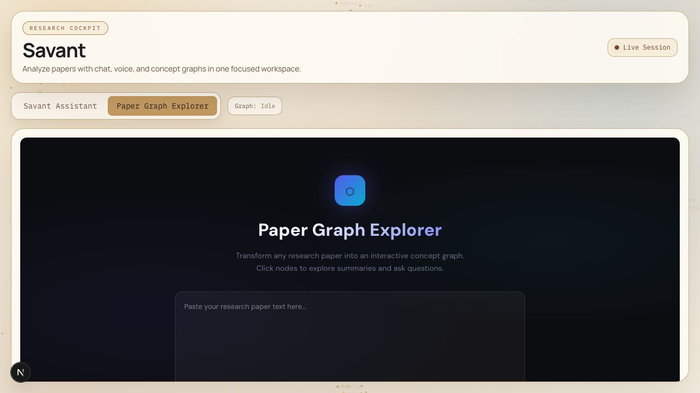
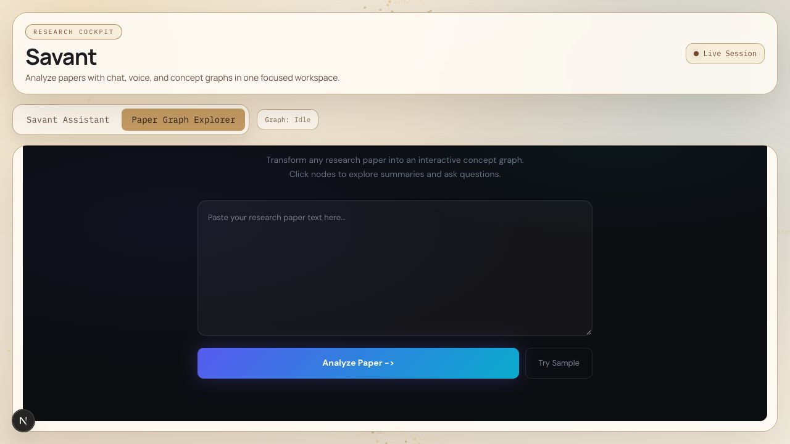
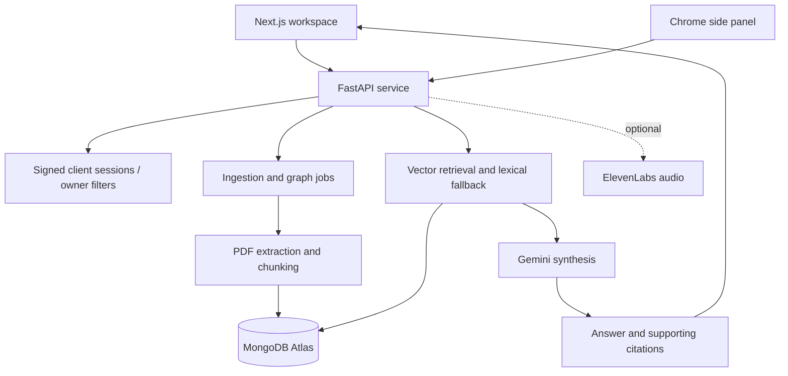

# Savant AI — product and engineering walkthrough

**Context:** HackCU team project · **My work:** frontend integration and debugging, graph typing, speech types, backend error handling · **Source:** public

[Repository](https://github.com/Sansh28/savant-ai) · [My contribution examples](#my-contributions) · [Back to profile](../README.md)

## What the product is for

Savant helps a reader move from a research paper to questions, supporting citations, and a concept graph. A Next.js application, FastAPI backend, and Chrome extension share document and graph workflows backed by MongoDB Atlas and Gemini.

Savant received the MLH MongoDB Track award at HackCU, as recorded in my [portfolio project background](https://sansh-portfolio.vercel.app/#projects). It was team work; the architecture below describes the system, while the contribution section identifies changes supported by my commit history.

## 1. Enter a research workspace

The first-run guide explains a three-step loop: upload a paper, ask a focused question, and verify the evidence. Conversation organization gives the user a place to return to their work.

*Actual local application screenshot, October 15, 2026. No paper is loaded and no generated answer is shown. The application's “Live Session” label does not indicate a connected backend in this capture.*

## 2. Upload and retrieve evidence

With backend services configured, upload one non-confidential PDF. The implementation creates document metadata and an ingestion job, extracts page text, chunks it, and stores retrieval material. The frontend polls for job completion before document-aware questions can proceed.

Useful first questions are: “What problem does this paper address?” and “Which evidence supports its main conclusion?” The query path combines vector retrieval with lexical fallback and returns supporting citations with its answer. A user should inspect the cited material rather than treat generated text as verified fact.

**Capture boundary:** this is a source-supported walkthrough of the intended flow. Upload, retrieval, and generation were not completed in the screenshot session because no backend/provider environment was connected.

## 3. Explore the graph surface

The graph interface accepts paper context and is designed for selecting concepts and following related questions. The current source also supports revisiting document-bound graph workspaces.

*Actual graph entry screen. This is not a successfully generated graph.*

The built-in **Try Sample** control was exercised locally. Without a reachable backend, it produced a visible fetch warning. That limitation is captured below rather than replaced with invented graph output.

Observed backend-unavailable state

## My contributions

| Contribution supported by history | Engineering significance | Public evidence |
| --- | --- | --- |
| Corrected graph layout typing to use D3's positioned hierarchy nodes | Aligns the stored graph reference with the layout result consumed by rendering | [Graph change](https://github.com/Sansh28/savant-ai/commit/fe574d0d741f11f50ce395b1bc993f742ec2578f) |
| Repaired conversation timestamp typing and state-restoration handling | Handles persisted conversation values more explicitly in the frontend | [Conversation change](https://github.com/Sansh28/savant-ai/commit/329ddefec2ea3c177620fa99b3aef3bb0538cc40) |
| Updated speech-recognition type dependencies | Supports TypeScript integration with browser speech APIs | [Speech type change](https://github.com/Sansh28/savant-ai/commit/071c63b) |
| Fixed an unbound local error in the Gemini call path | Repairs an exception-path failure in the backend | [Backend fix](https://github.com/Sansh28/savant-ai/commit/9589812b30ea90f44d2b33e72802f8b5b470f0f3) |

I also committed the initial combined project snapshot. That import is not proof that I independently authored every file; other contributors are visible in the repository history. Later authentication, jobs, and UX changes below describe the current project, not exclusively my individual work.

## System architecture

## Architecture decisions worth discussing

| Implemented choice | Benefit | Trade-off |
| --- | --- | --- |
| Separate web, backend, and extension packages | Multiple interfaces can share the same research services | Requires coordinated API and deployment configuration |
| Retain page/chunk metadata alongside text | Answers can point readers toward supporting material | Citation presence alone does not establish correctness |
| Vector retrieval with lexical fallback | Provides a degraded path when embeddings are unavailable | Retrieval quality differs between modes and needs evaluation |
| Document/job lifecycle and frontend polling | Makes long-running ingestion and graph work visible | Current in-process task execution is not a durable worker system |
| Document-bound graph persistence | Allows revisiting research work without regenerating everything | Ownership and stale-state handling must remain consistent |
| Backend-issued signed session tokens and owner filters | Avoids accepting arbitrary client owner strings as authority | This is a client-session boundary, not full user account authentication |

Source anchors: [document/job routes](https://github.com/Sansh28/savant-ai/blob/main/apps/backend/src/savant_backend/routers/documents.py), [retrieval services](https://github.com/Sansh28/savant-ai/blob/main/apps/backend/src/savant_backend/services/backend_services.py), [session security](https://github.com/Sansh28/savant-ai/blob/main/apps/backend/src/savant_backend/security.py), [web orchestration](https://github.com/Sansh28/savant-ai/blob/main/apps/frontend/src/app/page.tsx).

## Validation and current limits

The local frontend rendered, assistant/graph navigation worked, and the backend-unavailable state was observed. Screenshots are unmodified application captures. The canonical frontend lockfile failed a clean install due to missing optional dependency entries; a local install without rewriting the lockfile allowed this UI capture. No dependency or application-code repair is included in this publication.

MongoDB/provider integration, PDF question answering, generated graphs, extension behavior, and audio were not verified in this session. No accuracy, latency, load, or production-readiness result is claimed. Some older architecture notes predate the signed-session and job implementation; the source links above are the reference for those specific details.

## A useful next engineering iteration

Restore reproducible installation, configure a disposable backend environment, and record an upload → question → citation → graph run with a public sample paper. Then measure retrieval quality on a fixed question set and test failure/restart behavior before advertising a hosted demo.

[Read the source →](https://github.com/Sansh28/savant-ai)
