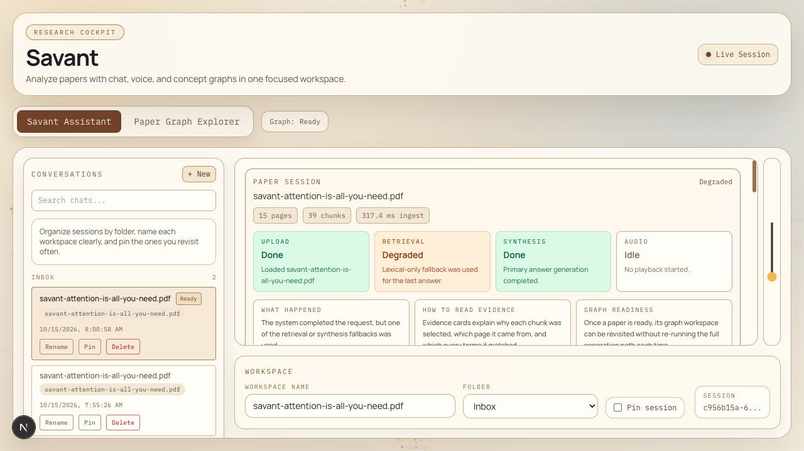
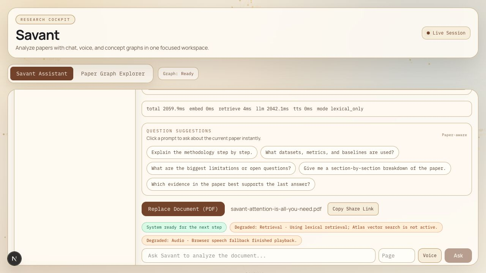
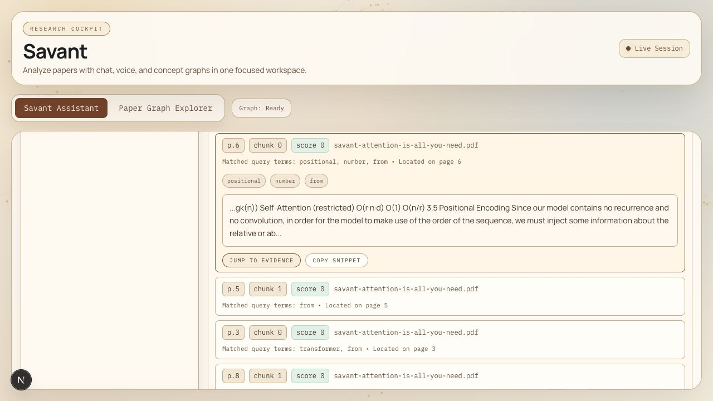
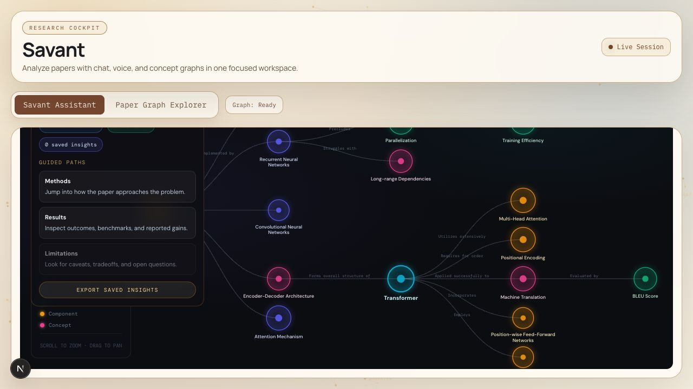
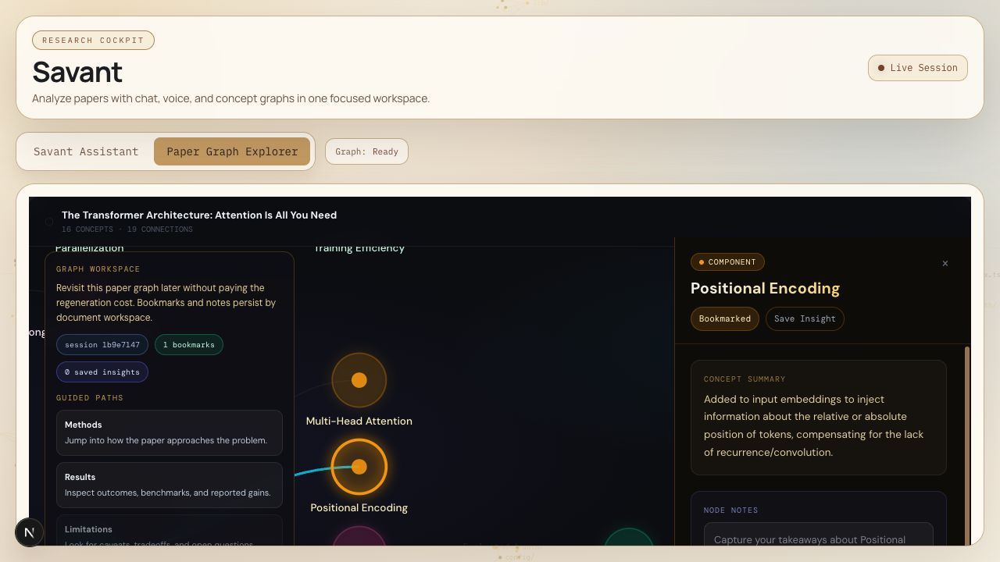
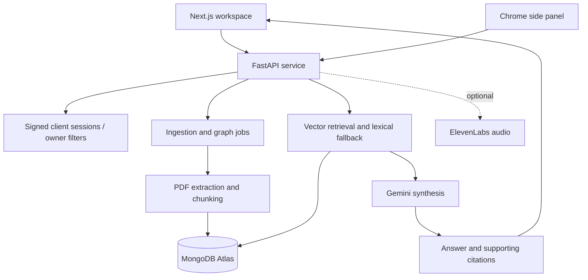

# Savant AI — product and engineering walkthrough

**Context:** HackCU team project · **My work:** frontend integration and debugging, graph typing, speech types, backend error handling · **Source:** public

[Repository](https://github.com/Sansh28/savant-ai) · [My contribution examples](#my-contributions) · [Back to profile](../README.md)

## What the product is for

Savant helps a reader move from a research paper to questions, supporting citations, and a concept graph. A Next.js application, FastAPI backend, and Chrome extension share document and graph workflows backed by MongoDB Atlas and Gemini.

Savant received the MLH MongoDB Track award at HackCU, as recorded in my [portfolio project background](https://sansh-portfolio.vercel.app/#projects). It was team work; the architecture below describes the system, while the contribution section identifies changes supported by my commit history.

## Verified local run — October 15, 2026

The complete PDF → answer → citation → graph flow now runs with a real FastAPI
backend, dedicated local MongoDB, and Gemini. The demonstration uses Vaswani et
al.'s [Attention Is All You Need](https://arxiv.org/abs/1706.03762), downloaded from
arXiv. No private documents or provider keys are shown.

**Retrieval disclosure:** this local database uses lexical retrieval, not Atlas
Vector Search. The app explicitly labels that path as degraded. Gemini generated
the answers and graph; local answer synthesis fallback was disabled.

## 1. Upload and ingest a real PDF

The first-run guide explains a three-step loop: upload a paper, ask a focused question, and verify the evidence. Conversation organization gives the user a place to return to their work.

*Actual connected application: the uploaded paper was parsed into 15 pages and
39 chunks. Those are observed document counts, not a benchmark.*

## 2. Upload and retrieve evidence

The upload creates document metadata and an ingestion job, extracts text, chunks
the pages, and stores retrieval material. The frontend now keeps the document
unavailable until that job completes, preventing premature queries and graphs.

Useful first questions are: “What problem does this paper address?” and “Which evidence supports its main conclusion?” The query path combines vector retrieval with lexical fallback and returns supporting citations with its answer. A user should inspect the cited material rather than treat generated text as verified fact.

I asked why the Transformer uses positional encoding. Gemini returned an answer
referring to **PDF page 6**, with five retrieved evidence cards. I checked that
page's positional-encoding section against the answer.

The expanded card shows a query-relevant passage instead of only the start of a
chunk. **Jump to Evidence** sets the follow-up page filter to 6; it does not open
an embedded PDF viewer. A displayed lexical score of zero is not a measured
semantic confidence score.

## 3. Explore the graph surface

The graph interface accepts paper context and is designed for selecting concepts and following related questions. The current source also supports revisiting document-bound graph workspaces.

*Real Gemini-generated output for the uploaded document: 16 concepts and 19
connections in this run. Generation can vary between runs.*

Selecting **Positional Encoding** opened its summary. I bookmarked the concept,
then reloaded the application: the conversation, answer/citations, cached graph,
selected concept, and bookmark were restored.

## My contributions

| Contribution supported by history | Engineering significance | Public evidence |
| --- | --- | --- |
| Corrected graph layout typing to use D3's positioned hierarchy nodes | Aligns the stored graph reference with the layout result consumed by rendering | [Graph change](https://github.com/Sansh28/savant-ai/commit/fe574d0d741f11f50ce395b1bc993f742ec2578f) |
| Repaired conversation timestamp typing and state-restoration handling | Handles persisted conversation values more explicitly in the frontend | [Conversation change](https://github.com/Sansh28/savant-ai/commit/329ddefec2ea3c177620fa99b3aef3bb0538cc40) |
| Updated speech-recognition type dependencies | Supports TypeScript integration with browser speech APIs | [Speech type change](https://github.com/Sansh28/savant-ai/commit/071c63b) |
| Fixed an unbound local error in the Gemini call path | Repairs an exception-path failure in the backend | [Backend fix](https://github.com/Sansh28/savant-ai/commit/9589812b30ea90f44d2b33e72802f8b5b470f0f3) |

I also committed the initial combined project snapshot. That import is not proof that I independently authored every file; other contributors are visible in the repository history. Later authentication, jobs, and UX changes below describe the current project, not exclusively my individual work.

For this local integration pass I repaired configured MongoDB startup, installation
reproducibility, client-session and conversation-state races, document-readiness
timing, and graph workspace restoration. I also added page labels to model context
after observing an incorrect page citation, improved citation excerpts, and added
regression coverage. [Integration changes](https://github.com/Sansh28/savant-ai/commit/2663a13) · [Implementation and verification record](https://github.com/Sansh28/savant-ai/blob/main/docs/DEMO_VERIFICATION.md).

## System architecture

## Architecture decisions worth discussing

| Implemented choice | Benefit | Trade-off |
| --- | --- | --- |
| Separate web, backend, and extension packages | Multiple interfaces can share the same research services | Requires coordinated API and deployment configuration |
| Retain page/chunk metadata alongside text | Answers can point readers toward supporting material | Citation presence alone does not establish correctness |
| Vector retrieval with lexical fallback | Provides a degraded path when embeddings are unavailable | Retrieval quality differs between modes and needs evaluation |
| Document/job lifecycle and frontend polling | Makes long-running ingestion and graph work visible | Current in-process task execution is not a durable worker system |
| Document-bound graph persistence | Allows revisiting research work without regenerating everything | Ownership and stale-state handling must remain consistent |
| Backend-issued signed session tokens and owner filters | Avoids accepting arbitrary client owner strings as authority | This is a client-session boundary, not full user account authentication |

Source anchors: [document/job routes](https://github.com/Sansh28/savant-ai/blob/main/apps/backend/src/savant_backend/routers/documents.py), [retrieval services](https://github.com/Sansh28/savant-ai/blob/main/apps/backend/src/savant_backend/services/backend_services.py), [session security](https://github.com/Sansh28/savant-ai/blob/main/apps/backend/src/savant_backend/security.py), [web orchestration](https://github.com/Sansh28/savant-ai/blob/main/apps/frontend/src/app/page.tsx).

## Validation and current limits

Screenshots are unmodified application captures from a connected local run.
Backend checks passed 16 tests plus Ruff; frontend checks passed 9 tests,
TypeScript, ESLint, and production build; extension checks passed 7 tests,
typecheck, and build. The extension was not exercised in-browser during this run.

Live checks additionally confirmed no-token access returns 401 and another client
cannot read the uploaded document (404). These checks are distinct from the mocked
unit/API/component suites. Installation instructions are in the
[local demo guide](https://github.com/Sansh28/savant-ai/blob/main/docs/LOCAL_DEMO.md).

This demonstrates one public paper on local MongoDB with real Gemini generation.
It does not validate Atlas vector search, a hosted backend, retrieval accuracy
over a dataset, production load, or ElevenLabs. No accuracy, speed, or production
readiness claim is made from one demonstration.

## A useful next engineering iteration

Validate the Atlas vector index and hosted backend separately, evaluate retrieval
and citation quality on a fixed question set, and introduce durable job recovery
before advertising production readiness.

[Read the source →](https://github.com/Sansh28/savant-ai)
